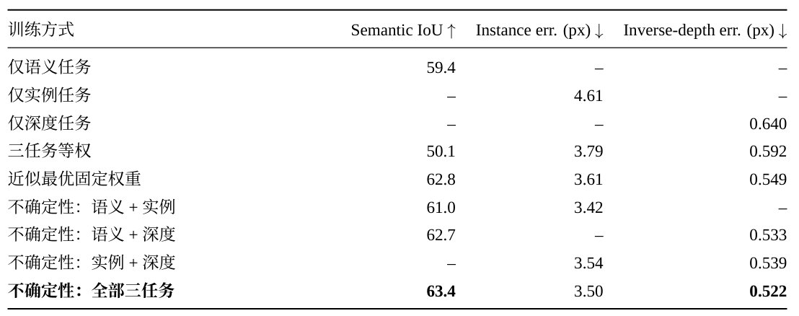
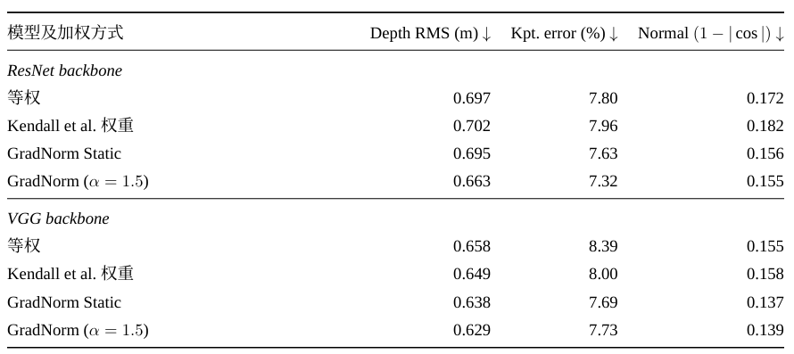

考虑多任务学习：针对同一个输入，需要输出两个甚至更多预测结果；因此多个预测结果之间如何进行 trade-off 是一个重要问题。

通常网络由两类参数构成，即共享参数 $\theta_s$ 与任务 $i$ 专属的参数 $\theta_i$

任务 $i$ 的损失由此可表示为 $L_i(\theta_s,\theta_i)$。

我们优化的目标通常是 $\sum_i w_iL_i$，其中 $w_i$ 是相应任务的权重。

自然，预先固定 $w_i$ 不失为一种方向，我们不由得思考：既然损失通过梯度下降的方式来优化，那么是否存在一种合理的方法，使得我们可以动态地、对结果有利地更新 $w_i$？

先考虑一个回归任务对应的概率模型：设模型对 $x$ 的回归预测为 $f(x;\theta)$，令观测 $p(y\mid x,\theta,\sigma)$ 服从高斯分布，即有

$$
-\log p(y\mid x,\theta,\sigma) = \frac1{2\sigma^2}\left(y-f(x;\theta)\right)^2+\log \sigma + C
$$

可写作

$$
\mathcal J_{\text{reg}}(\theta,\sigma) = \frac1{2\sigma^2}\mathcal L_{\text{reg}}(\theta)+\log\sigma
$$

多个回归任务假设独立的情况下，运用对数做加法即可。

接下来考虑分类任务，按照如下 Softmax：

$$
p(y=c\mid\boldsymbol z,\sigma) = \frac{\exp(z_c/\sigma^2)}{\sum_k\exp(z_k/\sigma^2)}
$$

取负对数后可得

$$
-\log p(y=c\mid \boldsymbol z, \sigma) = \frac1{\sigma^2}\mathcal L_{\text{CE}}(\boldsymbol z, c) + R(\boldsymbol z, \sigma)
$$

其中利用

$$
\frac1\sigma \sum_k\exp(z_k/\sigma^2) \approx \left(\sum_k\exp z_k\right)^{1/\sigma^2}
$$

可近似得到

$$
\mathcal J_{\text{cls}}\approx\frac1{\sigma^2}\mathcal L_{\text{CE}}+\log\sigma
$$

将两方面任务的 $\mathcal J$ 相加可得最终需要优化的值，实际上学习 $s=\log \sigma^2$ 是相对方便的。

Kendall et al. (2018) 中就在 Tiny Cityscapes 上训练了三个任务，其中带 Uncertainty 的训练方式表现良好。

在 GradNorm (Chen et al. (2018)) 中，考虑多任务训练步 $t$，选取一组共享的网络参数 $\mathcal W$，取加权梯度向量的范数

$$
G_i(t) = \|\nabla_{\mathcal W}[w_i(t)L_i(t)]\|_2
$$

首先，计算出所有 $G_i$ 的平均值 $\bar{G}$，并且，求 $\widetilde{L}_i(t)=L_i(t)/L_i(0)$，定义

$$
r_i(t) = \frac{T\widetilde{L}_i(t)}{\sum_j\widetilde{L}_j(t)}
$$

再令 $G_i^{\text{target}}(t)=\bar{G}(t)[r_i(t)]^\alpha$，其中 $\alpha$ 为超参数。

定义梯度平衡辅助损失：

$$
\mathcal L_{\text{grad}}(t;w) = \sum_{i=1}^T |G_i(t) - \operatorname{stopgrad}(G_i^{\text{target}}(t))|
$$

最终结果也比较 promising：

